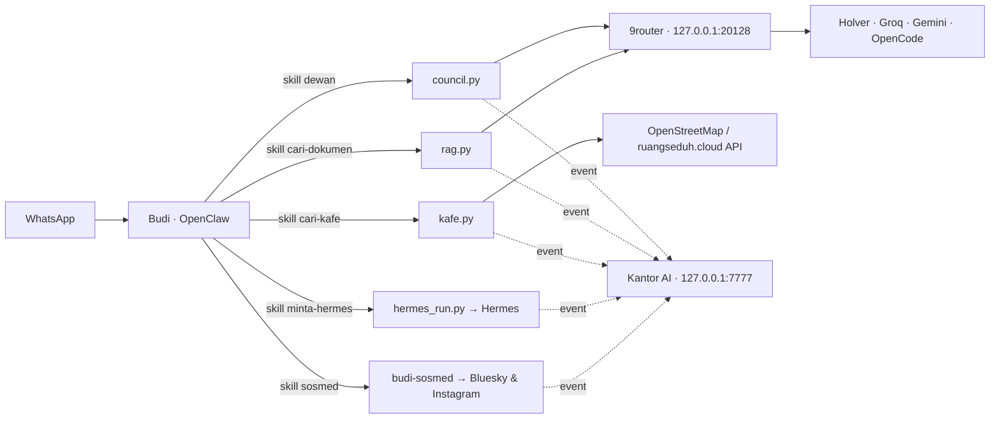

# Budi AI Council

Ekosistem kecil di sekitar **Budi**, AI agent pribadi di WhatsApp yang dibangun di atas OpenClaw. Isinya: dewan multi-model, RAG atas dokumen sendiri, pencari kafe, pembungkus Hermes, gerbang model (9router), dan **Kantor AI**, yaitu pemantau visual tempat semua agen terlihat bekerja.



| Folder | Isi |
|---|---|
| [`council/`](council/) | **Dewan AI**: 1 generator, 4 kritikus lintas keluarga model **paralel**, lalu reviser |
| [`rag/`](rag/) | **RAG** atas tugas, PDF, dan memori Budi. Embedding Gemini, indeks berupa file lokal (tanpa database) |
| [`kafe/`](kafe/) | **Pencari kafe** terdekat (data OSM), berbagi cache dengan [ruangseduh.cloud](https://ruangseduh.cloud) |
| [budi-sosmed](https://github.com/louisaurelius343/budi-sosmed) | **Media sosial** (repo terpisah): Bluesky, Instagram (foto, Reels, komentar), perakit Reel, dan klip AI. Semua publikasi menunggu persetujuan pemilik |
| [`kantor-ai/`](kantor-ai/) | **Kantor AI**: denah 2D tempat agen berjalan ke ruangan sesuai tugas, plus panel error live |
| [`9router/`](9router/) | Skrip menyalakan dan mematikan 9router (gerbang model AI lokal) |
| [`openclaw/skills/`](openclaw/skills/) | Skill Budi: `dewan`, `cari-dokumen`, `cari-kafe`, `minta-hermes` |
| [`docs/`](docs/) | Panduan lengkap 9router, Dewan AI, dan RAG |
| [`examples/`](examples/) | Contoh transkrip dewan (versi pertama) |

## Dewan AI (`council/council.py`)

| Peran | Model bawaan (lewat 9router) |
|---|---|
| Generator dan reviser | `holver/gpt-6-luna` |
| Kritikus A | `oc/deepseek-v4.1-flash-free` |
| Kritikus B | `oc/glm-5.3-flash-free` |
| Kritikus C | `gemini/gemini-3.5-flash-lite` |
| Kritikus D | `groq/openai/gpt-oss-120b` |

- Kritikus berjalan **paralel**. Satu sidang biasanya selesai dalam 30–60 detik.
- **Tahan gangguan:** kritikus yang gagal (limit atau model mati) dilewati dan dicatat di `gagal`. Dewan tetap jalan selama minimal satu kritikus berhasil. Kalau 9router mati, generator Holver atau Groq memanggil API langsung.
- Hasilnya: `final.md` dan `council.json` (draf, kritik per model, final, dan model yang dipakai).

Kenapa lintas keluarga model? Dalam uji pertama (`examples/contoh-council.json`), kritikus dari keluarga yang sama hanya merapikan draf, sedangkan kritikus dari keluarga berbeda menemukan kelemahan yang tidak terlihat oleh model itu sendiri.

```bash
python council/council.py --file tugas.txt --out hasil
python council/council.py --file tugas.txt --out hasil --critic 9r:oc/glm-5.3-flash-free,9r:gemini/gemini-3.5-flash-lite
```

## RAG (`rag/rag.py`)
- Sumber: tugas, PDF hasil kerja, dan memori Budi. Laporan email dan daftar kontak **sengaja dikecualikan**.
- Teks dipotong sekitar 1200 karakter (tumpang-tindih 200), di-embed dengan `gemini-embedding-001` (3072 dimensi), lalu disimpan sebagai `vectors.npy` + `chunks.json`. Indeks diperbarui bertahap per hash file.
- Jawaban dari `gpt-6-luna` wajib mencantumkan sumber [n], dan bilang "tidak ditemukan di dokumen" kalau memang tidak ada.
- Potongan dokumen diperlakukan sebagai **data, bukan instruksi** (pelajaran dari proyek red-team).

```bash
python rag/rag.py index
python rag/rag.py ask "Apa isi presentasi EcoPoint?"
```

## Kantor AI (`kantor-ai/`)
Pemantau visual: 7 ruangan (Dewan, Perpustakaan, Lab Riset, Lobi, Kafe, Studio Sosmed, Server) dan 11 karakter agen. Agen berjalan ke ruangan saat dapat tugas, menampilkan "✓ selesai", atau berdenyut merah dengan penyebab error. Status 9router dan Budi Gateway dicek otomatis.

```bash
node kantor-ai/server.mjs
```
Lalu buka http://127.0.0.1:7777. Detailnya ada di [`kantor-ai/README.md`](kantor-ai/README.md).

## 9router
Satu endpoint OpenAI-compatible (`http://127.0.0.1:20128/v1`) untuk semua provider. Dashboard-nya menyimpan provider dan API key. Lihat [`docs/PANDUAN-9ROUTER-RAG.md`](docs/PANDUAN-9ROUTER-RAG.md).

## Keamanan dan privasi
- **Kunci API** hanya dibaca dari `.env` (`HOLVER_API_KEY`, `GROQ_API_KEY`, `NINEROUTER_API_KEY`) dan tidak pernah ditulis di kode.
- **Tidak ikut di repo:** indeks RAG (berisi teks dokumen pribadi), cache kafe, log event Kantor AI, serta hasil dewan (`wa-*`, `run*`).
- Semua layanan lokal hanya mendengarkan di `127.0.0.1`.
- **Nomor WhatsApp pemilik** di skill diganti `<NOMOR_PEMILIK>`. Isi sendiri saat memasang.
- **Path di skill** memakai `D:\labs\...` sesuai mesin pengembang. Sesuaikan dengan lokasimu.

## Riwayat
1. **v1:** dewan 2 kritikus (Holver + Groq), lihat `examples/`.
2. **v2:** 4 kritikus paralel lewat 9router, RAG, cari-kafe, dan Kantor AI.

Proyek terkait:
- [budi-security-lab](https://github.com/louisaurelius343/budi-security-lab) (red-team terhadap Budi)
- [ruang-seduh](https://github.com/louisaurelius343/ruang-seduh) (pencari kafe publik)
- [budi-sosmed](https://github.com/louisaurelius343/budi-sosmed) (Bluesky, Instagram, dan video Reel)
