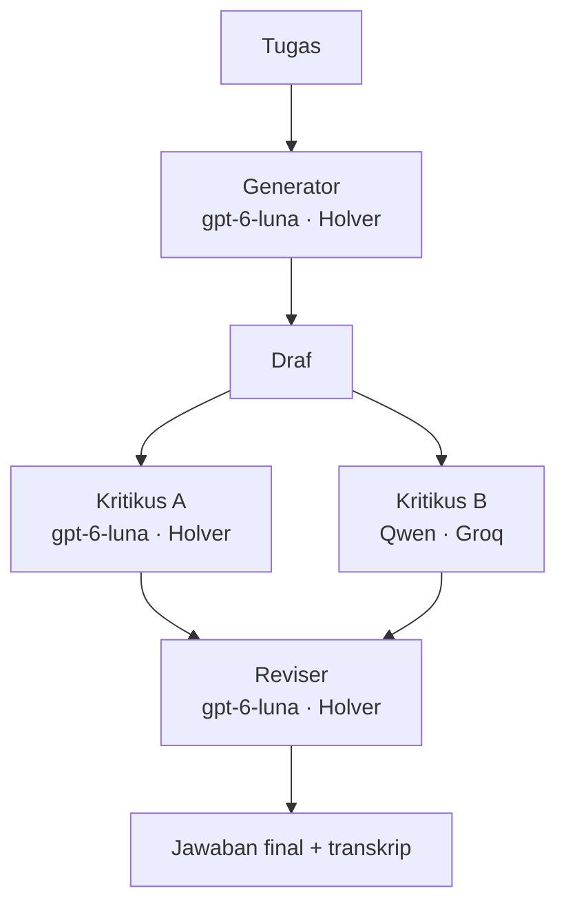

# Budi AI Council

Orkestrasi **multi-model**: beberapa LLM dari keluarga berbeda berkolaborasi pada satu tugas. Satu membuat draf, dua mengkritik, satu menyatukan jadi jawaban final. Dipicu dari WhatsApp lewat agent "Budi" (OpenClaw).

Teknik yang dipakai: **LLM-as-judge** dan **Reflexion** (model mengkritik lalu merevisi), diperkuat dengan **panel kritikus lintas-keluarga** untuk diversitas sudut pandang.

## Alur



## Peran & model

| Peran | Model | Penyedia |
|---|---|---|
| Generator (draf) | gpt-6-luna | Holver (OpenAI-compatible) |
| Kritikus A | gpt-6-luna | Holver |
| Kritikus B | qwen/qwen3.8-27b | Groq |
| Reviser (final) | gpt-6-luna | Holver |

Logika dewan ada **di kode** (`council.py`), bukan obrolan bebas antar-agent. Ini menjaga alur tetap pasti dan biaya terkendali — model hanya mengisi peran.

## Kenapa ini berguna (bukti nyata)

Dalam satu uji (teknik Pomodoro, lihat `examples/contoh-council.json`):
- **Kritikus A** (self-critique gpt-6-luna) hanya melunakkan klaim dan merapikan — perbaikan halus.
- **Kritikus B** (Qwen, keluarga berbeda) jauh lebih tajam: menuntut mekanisme psikologis, menyebut *flow state*, dan alternatif konkret.

Qwen menangkap kelemahan yang **tidak terlihat** oleh model saat mengkritik dirinya sendiri. Final menyatukan keduanya dan jelas lebih bernas dari draf. Inilah nilai "dewan dari pikiran yang berbeda".

## Menjalankan

```bash
python council/council.py --file tugas.txt --out run1
# ganti kritikus: --critic groq:openai/gpt-oss-120b
```

API key dibaca dari `.env` (`HOLVER_API_KEY`, `GROQ_API_KEY`) — tidak pernah ditulis di kode. Output: `council.json` (transkrip lengkap) + `final.md`.

## Menambah model

Penyedia apa pun yang **OpenAI-compatible** bisa dipakai (OpenRouter, DeepSeek, Kimi, Together, …):

1. Simpan key ke `.env` (mis. `OPENROUTER_API_KEY=...`).
2. Tambah baris di `PROVIDERS` dalam `council.py`: `"nama": ("<base_url>/v1", "<NAMA_ENV_KEY>")`.
3. Pakai lewat `--critic <nama>:<id_model>`.

## Integrasi Budi

Skill `openclaw/skills/dewan/SKILL.md` membuat Budi: menulis tugas ke file → menjalankan `council.py` → mengirim final + "catatan dewan" (apa yang ditemukan tiap kritikus) ke WhatsApp. Hanya lewat chat pribadi pemilik, karena memakai kuota beberapa model.

**Catatan penting:** model percakapan Budi sendiri (via login ChatGPT/codex) **tidak ikut** berdeliberasi. Budi hanya pemicu dan pelapor; dewan sepenuhnya dijalankan oleh Holver + Groq.

## Keterbatasan (jujur)

- Satu run = 4 panggilan model → lebih lambat & boros kuota. Berguna untuk tugas berkualitas tinggi, bukan pertanyaan sepele.
- Holver hanya mengekspos satu model (gpt-6-luna), jadi generator + kritikus A + reviser adalah otak yang sama. **Diversitas sejati datang dari Qwen (Groq).** Menambah penyedia lain akan memperkaya dewan.
- Kritik otomatis bisa keliru; reviser diminta mengabaikan masukan yang tidak valid, tapi tetap perlu penilaian manusia untuk tugas penting.

## Yang saya pelajari

- Orkestrasi multi-model & pola LLM-as-judge / Reflexion
- Memanggil beberapa API OpenAI-compatible dari satu orkestrator
- Nilai diversitas model: kritikus lintas-keluarga menangkap hal yang terlewat oleh self-critique
- Menaruh logika kontrol di kode agar biaya & alur terkendali
- Mengintegrasikan pipeline ke agent WhatsApp dengan batas akses
